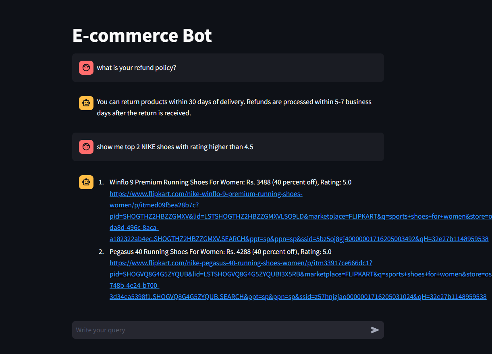
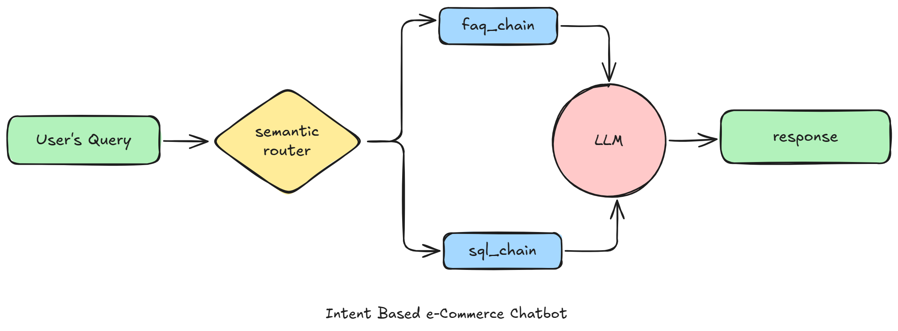

# flipkart-product-chatbot

# 💬 e-commerce chatbot (Gen AI RAG project using LLama3.3 and GROQ)

This is POC of an intelligent chatbot tailored for an e-commerce platform, enabling seamless user interactions by accurately identifying the intent behind user queries. It leverages real-time access to the platform's database, allowing it to provide precise and up-to-date responses.

Folder structure
1. app: All the code for chatbot
2. web-scraping: Code to scrap e-commerce website 

This chatbot currently supports two intents:

- **faq**: Triggered when users ask questions related to the platform's policies or general information. eg. Is online payment available?
- **sql**: Activated when users request product listings or information based on real-time database queries. eg. Show me all nike shoes below Rs. 3000.





## Architecture



### Set-up & Execution

Use Python 3.12. A project-local `.venv` and VS Code interpreter settings have been created.
The application uses the existing `app/db.sqlite` product database; scraping is optional.

1. Open a terminal in the project root and activate the environment:

   ```bash
   source .venv/bin/activate
   ```

   To recreate the tested environment on an Apple Silicon Mac with Python 3.12:

   ```bash
   python3 -m venv .venv
   source .venv/bin/activate
   python -m pip install -r requirements.lock.txt
   ```

   For a different platform, install `requirements.txt` for the chatbot or
   `requirements-scraping.txt` for the chatbot plus notebook dependencies instead.

2. Edit `app/.env` and replace the placeholder with your own Groq API key:

   ```dotenv
   GROQ_API_KEY=your_groq_api_key_here
   GROQ_MODEL=openai/gpt-oss-120b
   ```

   Obtain the key at https://console.groq.com/keys. Keep it private.
   `.env` files are ignored by Git. The app loads this file regardless of the
   terminal's working directory. Restart the app after changing credentials.
   Without a key, the page displays setup instructions; live answers need a valid key.

3. Run the chatbot:

   ```bash
   python -m streamlit run app/main.py
   ```

   Open http://localhost:8501 (or the URL printed in the terminal).
   Stop it with Ctrl+C. In VS Code, you can also select **Run and Debug → Run chatbot (Streamlit)**.
   Do not use the plain Python Run button for `main.py`.
   The other app modules are imported automatically.
   Try “What is the return policy of the products?” or “Are there any shoes under Rs. 3000?”
   The embedding model is cached in `.cache/huggingface`; the first download needs internet.

4. In VS Code, run **Python: Select Interpreter** and select `.venv/bin/python`.
   For the scraping notebook, use **Select Kernel → Python Environments → .venv**.

### Local verification and individual modules

These setup checks do not call the Groq API:

```bash
python scripts/check_setup.py
python scripts/check_setup.py --models
python -m pip check
```

Check the configured Groq model with `python scripts/check_groq.py`.
To test real FAQ and product answers, run `python scripts/check_groq.py --live`;
this makes three completion requests using your account's quota.
The default is `openai/gpt-oss-120b`: Groq retired `llama-3.3-70b-versatile`
for free/developer accounts on August 16, 2026.
See https://console.groq.com/docs/deprecations for the migration notice.

The `--models` check downloads the model if needed, ingests FAQs, and checks both routes.
The standalone examples below work after adding your API key (FAQ and SQL call Groq):

```bash
python app/router.py
python app/faq.py
python app/sql.py
```

### Optional scraping and database import

`web-scrapping/flipkart_data_extraction.ipynb` requires a Chrome-compatible browser,
internet access, and the `.venv` notebook kernel. Selenium can download Chrome for Testing
and its matching driver into `.cache/selenium` when Chrome is absent. Check the browser with
`python scripts/check_browser.py`, then run the notebook cells from top to bottom.
The notebook saves CSV files in `web-scrapping`
when opened from the project root or that folder.
The refresh helper reads product JSON-LD and matching page-state pricing metadata.
If these change or requests are blocked, extraction can still fail; validation then
preserves the previous catalog. Chrome is only needed for separate browser checks,
not for the current catalog refresh. It is not required for the chatbot.

### Protected catalog refresh

From the project root, run:

```bash
.venv/bin/python scripts/refresh_catalog.py
```

This runs the scraping notebook with the project interpreter to refresh the same
product URLs already stored in the database. It reads structured product metadata
(price, rating, and rating count) and verifies each product ID. It no longer relies
on Flipkart's changing product-card CSS classes or keyword-search pagination. Only one
scheduled refresh command can run at a time. Each scrape gets a separate folder
in `web-scrapping/refresh-runs/`; existing CSVs are not overwritten.
Execution logs and completed notebooks are saved there as well.

The scraper continues through all product URLs after individual failures and retries
failed requests once. Successful responses must have valid product IDs, nonblank
names/brands, positive integer prices, discounts between 0 and 1, ratings between
0 and 5, and nonnegative integer rating counts. If a previously known discount,
rating, or rating count disappears, that entire product record is retained.

Valid products are updated; failed or invalid products keep their previous records.
No catalog rows are deleted. Before publication, the manifest must account for
every requested URL, and the catalog must still match the list that was scraped.
An interrupted run or a run with no valid updates preserves the whole catalog.

The previous database is backed up in `app/backups/`. All product updates and
refresh metadata are saved in one SQLite transaction; write errors roll back
all changes. `product_refresh_state` records each link's last successful refresh,
last attempt, status, and error. A failed product keeps its previous successful
refresh date. Existing records have an unknown refresh date until first refreshed.
`catalog_refresh_runs` records the number updated and retained for each publication.
The staging folder's `publication.json` also contains these counts and failures.

The saved catalog can therefore contain a mix of refreshed and older prices and
ratings; it is not a guarantee of live prices. New chatbot questions read the
saved database automatically; existing chat messages retain their previous answers.
The product response format is unchanged.

For a manually prepared CSV, the same validation and backup checks apply:

```bash
.venv/bin/python web-scrapping/csv_to_sqlite.py --csv app/resources/ecommerce_data_final.csv
```

The old ten-row `web-scrapping/flipkart_product_data.csv` is now rejected as an
unsafe replacement for the 903-row catalog. The manual CSV importer still requires a complete replacement and rejects
partial manifests; use the refresh command above for safe partial updates. To experiment with a separate empty
database, use `--db /tmp/ecommerce-test.sqlite`.

The refresh command can be invoked by a scheduler at your chosen interval; no
recurring schedule is installed automatically. A failed run exits with a nonzero
status and leaves its log for inspection. The command displays progress every
30 seconds; staging folders also contain `progress.json` and `failures.json`.
Individual failures do not stop other products from refreshing. A partial
publication exits successfully and reports updated/retained counts; a failed or
interrupted publication exits with a nonzero status. HTTP 503 means the retailer
returned Service Unavailable; failed products can be retried on the next run. Backups and staging folders are retained
until you choose to remove them.

Run the refresh safety checks with:

```bash
.venv/bin/python -m unittest discover -s tests -v
```

### Troubleshooting

- **Missing module:** activate `.venv` and use its interpreter in VS Code.
- **Invalid API key or model access:** check `app/.env` and your Groq console, then restart.
- **Model download failure:** check internet access, then rerun the `--models` setup check.
- **Port already used:** run `python -m streamlit run app/main.py --server.port 8502`.
- **Terminal tracebacks mentioning Streamlit's watcher and optional Transformers modules:**
  this project disables the file watcher in `.streamlit/config.toml`. Start Streamlit
  from the project root to load that configuration. After editing Python code,
  restart Streamlit to apply the changes.
- **Scraping timeout:** check Chrome and inspect Flipkart's current page selectors.


---

Copyright (C) Codebasics Inc. All rights reserved.

Additional Terms: This software is licensed under the MIT License. However, commercial use of this software is strictly prohibited without prior written permission from the author. Attribution must be given in all copies or substantial portions of the software.
